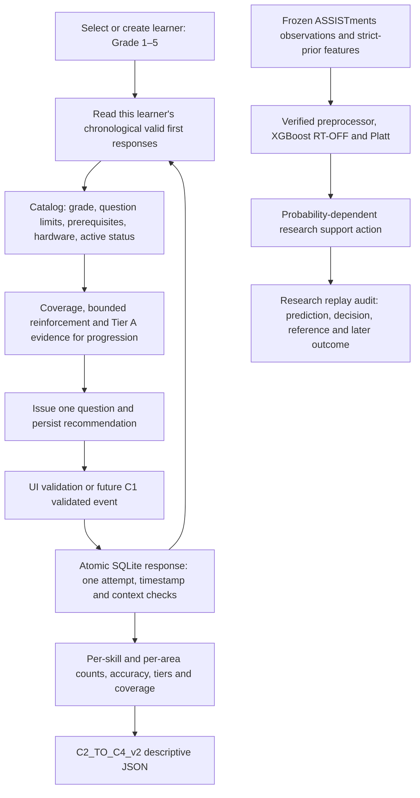

# Component 2 PP1 integration handover

> Historical handover. Superseded on 17 October 2026 by `TRAINED_MODEL_DEPLOYMENT_AUDIT.md`, `TRAINED_ML_GITHUB_TRANSFER.md`, and `TRAINED_ML_INTEGRATION_CHANGE_LOG.md`. Historical commands/evidence below describe the earlier rule/Beta-fallback build.

## Scope and implementation

Authoritative edited project:

`C:\Users\Monil A\Desktop\Research Documents\ASSISTments Dataset\06_PP1_Final_Component2\component-2-adaptive-game-engine`

This is the local final Component 2 application, not the separate GitHub clone. The existing service, database, catalog, question factory, coverage policy and Streamlit views were reused. No model fitting, full preprocessing run, C3 classification, C4 risk prediction, commit or push is part of this implementation. The original Step 1–5 research files and completed notebooks are source evidence.

The working local loop supports all five grades: create/select a learner, start/resume a session, obtain an eligible question, submit once, persist the validated first response, update the next recommendation and inspect/export the same learner's descriptive profile. The UI simulates C1; `Component2Service.ingest_c1` accepts future validated C1 events through the same transactional event writer.



## Curriculum and question policy

Evidence inspected: the project's `research/nie/NIE_Curriculum_Constraints_Draft.csv`, `NIE_Project_Skill_Mapping.csv`, and the saved audit at `C:\Users\Monil A\Desktop\Research Documents\07_C2_Curriculum_Research_Justification\C2_Game_Curriculum_Mapping.md`. Existing evidence was reused; no new NIE interpretation is presented as a verified outcome.

| Game | Tier A minimum grade | Tier B minimum grade | Actual bounded task |
|---|---:|---:|---|
| Counting | 1 | 1 | Display 1–5 or 6–9; represent with colored cubes |
| Comparison | 1 | 1 | Compare separated or adjacent single-digit values |
| Ordering | 1 | 2 | Step-one gap or explicit step-two gap |
| Place value | 2 | 2 | Two nonzero digits in Tens/Ones positions |
| Addition | 1 | 2 | Grade 1 sums at most 6; later A at most 10; B 11–18 |
| Subtraction | 1 | 2 | A starts at 2–6; B starts at 7–9; positive answers |
| Multiplication | 3 | 5 | A two equal groups; B factors 2–5 and products at most 25 |
| Division | 3 | 4 | A divides by 2; B by 3/4; exact sharing with displayed total at most 9 |

All 16 activity IDs are retained. Minimum grades are enforced by the catalog and independent question policy; direct question calls with a grade also reject unsupported combinations. Two numbered cubes maximum, single-digit numbered values and 1–25 correct colored-cube answers remain enforced. An answer of zero is accepted as a wrong response, not a correct generated answer.

Grade 1 subtraction remains explicitly `REQUIRES_CURRICULUM_VERIFICATION`: the topic is supported, but the exact early ceiling is a project bound. Grade 1 step-one ordering is a foundational adaptation. Grade 4–5 source readings require a second Sinhala-language review, as stated in the saved audit. The current questions are foundational samples for older grades, not comprehensive Grade 4/5 attainment assessment. Tier B multiplication is conservatively deferred to Grade 5 because the existing mixed factors 2–5 exceed the cited Grade 3/4 factor cases. Upper-grade learners retain access to suitable foundational reinforcement.

## Progression and coverage rationale

Cold start uses Counting A. Prerequisites are the existing two prior exposures; they indicate exposure, not mastery. Tier B requires at least three Tier A observations in the same skill, at least 75% accumulated Tier A correctness, and at least two correct responses in the most recent three skill responses. These retained project heuristics prevent single-answer promotion. They are not NIE attainment standards or validated clinical cutoffs.

Coverage first distributes responses across eligible games until each has at least three observations. Under-assessed ties favor the least recently sampled area. After that, recent errors can trigger reinforcement, but a third consecutive reinforcement question is blocked when alternatives exist. Least-recent rotation provides the alternative. Incorrect responses do not block curriculum coverage forever: prerequisite exposure can accumulate independently of correctness. Prerequisite, grade and hardware checks are never bypassed.

Coverage `COMPLETE` in the export means every grade-applicable skill has at least one observed response. It does not mean the three-observation policy minimum, mastery, reliability or comprehensive curriculum assessment. Counts remain visible for interpretation.

## Performance contract and migration

The requested operational map is versioned as `C2_OPERATIONAL_AREAS_v2`:

- A1 Number Sense: Counting, Comparison, Ordering.
- A2 Number Relationships: Place Value.
- A3 Arithmetic Calculation: Addition, Subtraction.
- A4 Multiplicative Reasoning: Multiplication, Division.

The earlier implementation used two games in each area. This implementation uses the user's current proposed reporting map; it does not assert that a domain expert approved it as a clinical factor model. Existing stored events remain unchanged. New profiles derive the reporting map from game identity, so old cached area labels cannot silently control v2 totals.

`C2_TO_C4_v2.0.0` is an explicit contract change. Area accuracy is now pooled correct responses divided by total valid responses, rather than an unweighted average requiring two games. An area with one observed skill may have a percentage and `PARTIAL` coverage. An unassessed area has `status=NOT_ASSESSED` and null accuracy. An area outside the current grade's eligible scope also has `coverage_status=NOT_APPLICABLE`. Historical observations remain visible, including when a learner's grade later changes.

Each skill/area reports attempts, correct/incorrect counts, observed accuracy, recent-window counts/accuracy, Tier A/B counts, distinct activity exposure, last activity and evidence labels. No confidence label is a statistical reliability estimate. Non-scoring event counts and excluded invalid/future valid records are visible. Response time is metadata only.

C4 must agree to the new schema before consuming v2. Shared C4 code was not changed. Example exports and recommendation JSON are generated by `tools/verify_pp1.py` under `docs/integration_evidence/grade_N_c4_profile.json` and `grade_N_recommendation.json`. Full synthetic traces are `grade_N_workflow.json`.

## C1 replacement interface

The Python boundary is `service.ingest_c1(payload)`; schema: `contracts/c1_ingestion.schema.json`.

```json
{
  "event_id": "unique-c1-event-id",
  "learner_id": "selected-learner-id",
  "session_id": "issued-session-id",
  "question_id": "issued-question-id",
  "activity_id": "issued-activity-id",
  "correct": 1,
  "attempt_count": 1,
  "timestamp": "2026-10-16T12:00:00+00:00",
  "response_ms": null
}
```

Use the actual issued IDs and response timestamp; the example is structural. C1 correctness must be integer 0/1. It is trusted as the validation result only after learner, session, active question and activity matching. C2 rejects retries, future/pre-question/time-reversing events and invalid metadata. Grade, game and tier are attached from the issued session/question. Duplicate event IDs are idempotent only for the same response context; second responses under a new event ID are rejected. A future transport layer still needs authentication, retry/error handling and agreed clock synchronization; this is currently an in-process boundary.

End/skip records an `UNANSWERED` non-scoring event for any pending question. Pause preserves it for resumption. Researcher/Child view switching preserves the selected learner. C4 download remains a clearly timestamped snapshot; regenerate it after new responses.

## ML compatibility and actual integration

The exact feature and preprocessing audit is in `MODEL_COMPATIBILITY_AUDIT.md`; the full 42-field order and exact artifact hashes are also recorded in `integration_evidence/research_replay.json`.

Local candidate encoding remains scientifically insufficient. Supplying strings named `assistments_skill_id` and `assistments_template_id` no longer turns a local activity into a supported candidate. Local `predicted_probability` is null and the UI states `RULE_BASED_FALLBACK`.

The Research replay view now connects genuine saved pre-response inputs to fresh frozen-model inference and a decision. It verifies the three artifacts, applies the preserved training engineering and preprocessing, selects the 335 RT-OFF transformed columns, calibrates probabilities, and checks each against the saved test prediction. Current outcomes are changed in an additional check; predictions must remain exactly unchanged.

An explicit illustrative policy chooses scaffolded practice below p=0.60, standard practice from 0.60 through 0.85, or consideration of a next challenge above 0.85. These are engineering demonstration thresholds, not empirical efficacy or clinical thresholds. This is a support recommendation for an observed research task, not scoring of hypothetical alternative activities. It avoids pretending that records with different learner histories form one interchangeable candidate set. The eight replay observations produce multiple support actions; controlled policy tests additionally verify that changing only probability can change the decision.

A deployable learned local game ranker still requires an approved task/context representation, compatible feature definitions, and local prediction/calibration/policy validation. No post-hoc semantic skill name can establish that transfer on its own.

## Run locally

From PowerShell:

```powershell
Set-Location -LiteralPath 'C:\Users\Monil A\Desktop\Research Documents\ASSISTments Dataset\06_PP1_Final_Component2\component-2-adaptive-game-engine'
$env:PYTHONPATH = 'src'
$env:C2_RESEARCH_WORKSPACE = 'C:\Users\Monil A\Desktop\Research Documents\ASSISTments Dataset'
.\.venv\Scripts\python.exe tools\verify_pp1.py
.\.venv\Scripts\python.exe -m streamlit run streamlit_app.py
```

Independent replay command:

```powershell
.\.venv\Scripts\python.exe tools\run_research_replay.py --workspace $env:C2_RESEARCH_WORKSPACE
```

The existing project-local environment was prepared for this task. A Windows long-path issue required installing Streamlit with an extended-length target path. On another machine, use a short checkout/environment path such as `C:\work\c2` to avoid that installation issue. Do not copy this virtual environment.

## Transfer to the separate GitHub clone

1. Review `integration_evidence/changed_files.json` and `FILE_CHANGE_SUMMARY.md`. Copy only these Component 2 source/config/contracts/tests/tools/docs changes into the corresponding component folder of your clone, comparing any changes already present there.
2. Include `requirements-test.txt` and the corrected `requirements-research.txt` if using the research view. PyArrow 21 is compatible with the pinned Streamlit requirement (<26); the previous PyArrow 26 pin conflicted with it.
3. Do not copy `.venv`, SQLite databases, `__pycache__`, real learner records or the external frozen research datasets. The frozen model manifest and relative artifact layout remain unchanged. The separate research workspace is referenced through `C2_RESEARCH_WORKSPACE`.
4. In the clone's Component 2 folder, run the commands below. Review the schema-v2 handoff with C4 before connecting it. No automatic Git operation is needed.

```powershell
py -3.12 -m venv .venv
.\.venv\Scripts\python.exe -m pip install -r requirements-test.txt -r requirements-research.txt
$env:PYTHONPATH = 'src'
$env:C2_RESEARCH_WORKSPACE = 'C:\path\to\ASSISTments Dataset'
.\.venv\Scripts\python.exe tools\verify_pp1.py
.\.venv\Scripts\python.exe -m streamlit run streamlit_app.py
```

Without research dependencies, install only runtime/test requirements and run the backend, question, end-to-end and UI tests; research-specific tests require their optional packages and external artifacts. The game loop runs without XGBoost or a robot.

## PP1 demonstration

Create a Grade 1 learner in Researcher view, select them and start a session. Switch to Child and submit Counting A once. Continue through several responses; observe coverage-driven changes, Grade 1 addition bounded to six, and the reason displayed above the question. Return to Researcher; verify the same learner remains selected and export the descriptive C4 profile. A2/A4 are not applicable to this grade's current scope. Repeat with a Grade 3 or Grade 5 learner to demonstrate the larger candidate set and prerequisites. Use a seeded strong-history learner for a short Tier B demonstration.

Open Research replay and run against the external workspace. Show the actual calibrated probabilities, saved-reference differences and the corresponding support decisions. State the local transfer limitation explicitly.

## Verification evidence and remaining work

Actual automated results are in `integration_evidence/test_results.txt` and `verification_summary.json`. The latter also records five grade-specific 36-response demonstrations. UI tests cover learner creation and repeated submissions at Grades 1 and 5, export, skip, pause, and explicit replay failure. Frozen-model tests include schema/width checks, invalid-input rejection, saved-reference agreement and target-outcome invariance.

Remaining work: C1 transport/authentication and hardware validation; C4 agreement on v2 semantics; teacher confirmation of bounded Grade 1 subtraction and scanned Grade 4/5 references; local usability, fairness and reliability studies; broader upper-grade tasks if required; and task representation plus local calibration/policy evaluation before learned local ranking can be claimed. The eight games do not comprehensively measure working memory, attention, executive functions, spatial reasoning, word problems or dyscalculia risk.
