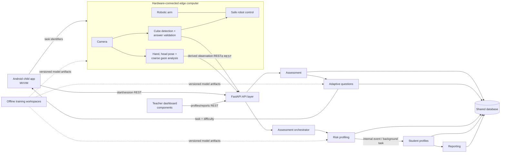

# Architecture

## Hybrid Edge-Enabled Client–Server Modular Monolith Architecture

The system keeps latency-sensitive and privacy-sensitive perception and hardware
control on the computer attached to the camera and robot. A FastAPI modular
monolith exposes immediate REST operations, coordinates module use cases, emits
internal events or background jobs, and initially persists through one shared
database. Module boundaries are explicit so an infrastructure adapter can later
move without changing domain rules.



## Module layering

Every research module follows this dependency direction:

```text
API -> Service -> Domain Logic -> Infrastructure ports/adapters
```

- `api.py` declares FastAPI routing only.
- `schemas.py` exposes request/response contracts.
- `service.py` implements application use cases and dependency injection.
- `domain/` owns framework-independent rules.
- specialised folders implement computer vision, model loading, persistence, or
  hardware adapters.
- `models/` loads versioned artifacts; it does not train them.

Cross-module coordination belongs in `backend/app/orchestration/`, not inside a
research module. Cross-module payloads belong in `shared/contracts/`.

## Deployment boundary

Camera capture, MediaPipe, cube detection, behaviour classification, and robotic
control must run on the edge computer. Continuous raw video upload is not
required. The backend receives derived, pseudonymous observations whenever
possible. If the edge and server run on one machine during development, this
logical boundary still applies.

The initial shared database simplifies transactions and operations. Modules must
access data through owned repository interfaces so shared storage does not become
shared business logic.
