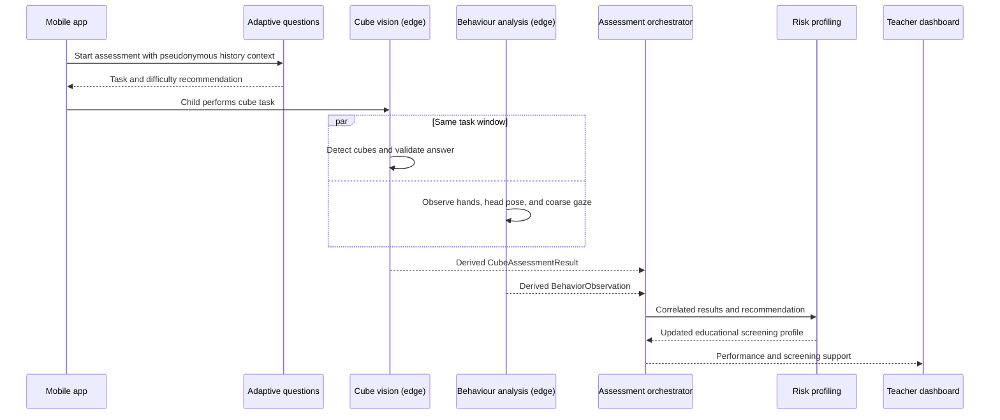

# Assessment data flow



The correlation key is the tuple of `pseudonymous_child_id`, `session_id`, and
`task_id`. All histories are chronological. Long-running profile updates should
use an internal event or background-task adapter and record model versions.

An edge-to-backend derived observation may look like:

```json
{
  "session_id": "session-001",
  "task_id": "task-005",
  "answer_correct": false,
  "response_time_ms": 8200,
  "finger_counting": true,
  "behavior_confidence": 0.89,
  "tracking_quality": 0.94
}
```

This example is a transport illustration, not research data or a model result.
Raw frames remain at the edge unless a separate, consented research protocol
explicitly requires secure collection.
